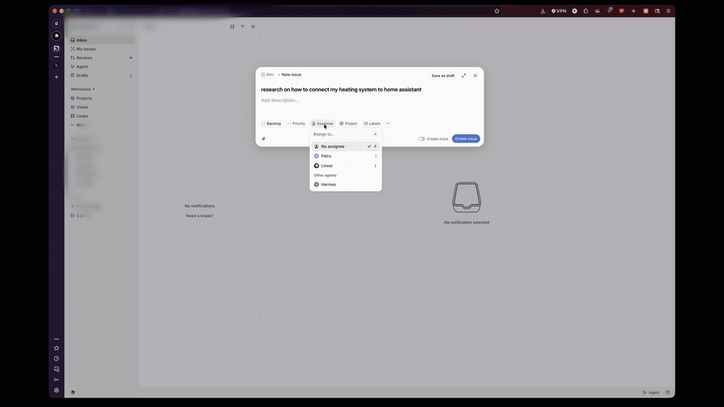

# linear-agent — make Hermes a first-class Linear agent

Assign a Linear issue to **Hermes**, or `@mention` it in a comment, and Hermes answers
in the thread **as its own agent identity** — not as you.

That last part is the whole point. The usual webhook trick has a flaw: an automation
that posts through a personal API key appears to be written by a human. Linear's agent
platform fixes it with an app actor (`actor=app`), and this plugin implements that
platform properly: signature-verified webhooks, agent activities, session lifecycle,
and a Hermes run behind it.

```
   Linear issue            ┌──────────── linear-agent bridge ────────────┐
   assign → Hermes         │                                             │
   or @mention             │  POST /webhook                              │
        │                  │   ├─ verify Linear-Signature (HMAC-SHA256)  │
        │   AgentSession   │   ├─ dedupe delivery-id + session-id        │
        └─────────────────►│   ├─ thought  "picked this up" (≤10s)       │
                           │   ├─ run  ──► Hermes gateway /v1/runs       │
                           │   └─ response  (posted as the app user)     │
                           └─────────────────────────────────────────────┘
                                        │
                          Linear thread shows: thought → progress → answer
```

## Demo

Create an issue, assign it to Hermes, and the answer lands in the thread authored by the
agent — this is the whole loop, unedited:



The full 61-second recording, 1080p: [docs/demo.mp4](docs/demo.mp4)

## Disclosures

What this plugin does that a user should know before installing:

- **Network calls to a third party.** The bridge talks to Linear (`api.linear.app`) to post
  agent activities and to read an issue’s labels, and to your local Hermes gateway over
  HTTP (`HERMES_GATEWAY_URL`, default `http://127.0.0.1:8642`) to run the agent.
- **It exposes a public HTTPS endpoint.** Registering the app gives Linear a URL that reaches
  `POST /webhook`; the same server answers `GET /healthz`, `GET /oauth/callback` and
  `GET /status`. The webhook rejects any request whose `Linear-Signature` does not verify.
- **Credentials it stores.** The Linear app OAuth token goes to `<data dir>/linear-tokens.json`
  at mode 0600 and is refreshed by the bridge itself. The three Linear credentials are
  Hermes' profile secrets, read through `agent.secret_scope`; the plugin never opens
  `.env` or another credential file. Only the non-secret public URL and the install-link
  key live in the plugin's own `settings.json` (mode 0600). Secrets are never logged,
  never echoed, and never printed by `doctor`.
- **Shell commands.** In gateway mode: none. In the fallback subprocess mode it runs
  `hermes chat -q` with a minimal environment, so the child never inherits the bridge’s secrets.
- **A long-running background process.** The bridge is a small always-on HTTP service (stdlib
  only). It runs outside Hermes, typically in Docker or under systemd.
- **Reads outside its own data.** The issue title, description and labels Linear sends it, and
  the Hermes profile list, to validate the agent profile you choose.
- **Identity.** Replies are posted with Linear’s `actor=app`, so the author is the app user,
  not the person who installed it. The personal-`LINEAR_API_KEY` fallback is off unless you set
  it on purpose, and it logs loudly when used.

## One command

```sh
hermes linear-agent setup
```

That is the whole install. It starts the bridge (or finds the one already running), prints
the callback URL fully formed so it is copied rather than composed, checks that Linear
can reach the public URL, and walks you through installing the app in your workspace.

Setup never stores a secret. The two app values and the webhook signing secret go through
Hermes: it prints the exact `hermes config set KEY <value>` lines, or you re-run
`hermes plugins install realpetru/hermes-linear-agent --force` for masked prompts.

It starts **no tunnel** and it **creates no webhook**: Linear's API refuses to create an
agent-session webhook for any participant token, so those two things are yours, and the step
that asks for them tells you exactly what to paste where.

The honest floor: **one command, three values pasted** (client id, client
secret, and the webhook signing secret Linear generates for the app), **one URL
pasted** into the app, **one click** to install. Everything else — bridge start,
token exchange, checks — is automatic.

* setup prints the **Webhook URL** and the category to pick, then the line
  `hermes config set LINEAR_WEBHOOK_SECRET <value>`. Linear shows the signing secret once,
  when you add the webhook; Hermes stores it in the profile. Linear has no API for an
  agent's own webhook, so that paste is the honest floor;
* the callback URL is printed ready to paste next to the app-creation link;
* the public URL is the one you already have. **This plugin does not create tunnels**:
  point a reverse proxy, a managed tunnel or a small VPS at the bridge port and pass the
  address in with `--public-url`, or set `LINEAR_AGENT_PUBLIC_URL`. Setup then calls
  `/healthz` on it and only reports `done` when it actually answers.

It is **resumable**: every step reports `done`, `skipped`, `needs you` or `FAILED`, and
re-running it picks up where you stopped. A second run creates nothing twice.

```sh
hermes linear-agent setup --json     # the same checklist, machine-readable
hermes linear-agent setup --yes      # never prompt; use only what is already configured
```

Whatever public address you use, it has to stay the same: the OAuth callback and the
webhook are registered against it. A free quick-tunnel hostname changes every restart,
which breaks both — use a stable address with a DNS name instead.

---

## Install

About 15 minutes, most of it in Linear's UI. You need **workspace admin** in Linear, a
**public HTTPS URL** that reaches this machine, and a machine that stays on. The short
version is below; [docs/INSTALL.md](docs/INSTALL.md) has the click-by-click, the Docker
path, and the systemd/launchd units.

### 1. Get a public URL

Linear will not POST to `localhost`, so the bridge needs a public HTTPS address. **This
plugin does not create one** — use whatever you already run: a reverse proxy on the host
(Caddy, Nginx), a managed tunnel, or a small VPS.

Whatever it is, it must forward to the bridge on `127.0.0.1:8650` (or your `PORT`), and the
address must stay the same for the life of the install: the app's Callback URL and the
Webhook URL are both registered against it. A free quick-tunnel hostname changes on every
restart, which breaks both — use a stable DNS name.

```sh
hermes linear-agent setup --public-url https://linear.example.com
```

Setup calls `/healthz` on that address and only reports `done` when it answers. See
[INSTALL §0](docs/INSTALL.md#0-a-public-https-url).

### 2. Create the Linear OAuth app

As a workspace admin: **Settings → API → Applications → New application**
(<https://linear.app/settings/api/applications/new>).

- **Name:** what you want people to @mention (`Hermes`). It is the agent's display name.
- **Callback URL:** `https://YOUR-PUBLIC-HOST/oauth/callback`
- Enable **Webhooks**, URL `https://YOUR-PUBLIC-HOST/webhook`, and tick
  **Agent session events**.
- Copy the three values: **client ID**, **client secret**, **webhook signing secret**.

Do not close the page; the next step asks for them.

### 3. Install the plugin

```bash
hermes plugins install realpetru/hermes-linear-agent
hermes plugins enable linear-agent
```

The installer prompts for the three values from step 2 and stores them in the Hermes
profile. If you skip a prompt, store each one later with `hermes config set
LINEAR_CLIENT_ID <value>` (and `LINEAR_CLIENT_SECRET`, `LINEAR_WEBHOOK_SECRET`); inside
Hermes the plugin reads them through the profile secret scope.

### 4. Run the bridge, then install the app

```bash
hermes linear-agent serve        # terminal 2 — leave running
hermes linear-agent authorize    # terminal 3 — open the URL as a workspace admin
```

Approve the install and you should land on **"Hermes installed"**. The app token is
stored `0600` and refreshes automatically.

### 5. Prove it before you touch an issue

```bash
hermes linear-agent doctor
```

Every line must say `ok`: the three credentials, the app token against Linear, the
public URL from the outside, the webhook signature, and the Hermes gateway. Only then:

### 6. Assign an issue

Assign any issue to **Hermes** — the *delegate* field, not the assignee — or @mention it.
A `thought` appears within ten seconds; the answer arrives as a `response` posted by
Hermes, not by you.

> A foreground `serve` dies with your terminal. Before you rely on this, install it as a
> service: [INSTALL §6](docs/INSTALL.md#6-keep-it-running).

## What you get

| Surface | What it does |
|---|---|
| `hermes linear-agent serve` | runs the webhook bridge |
| `hermes linear-agent status` | reachability, credentials, app token, the two URLs, sessions handled, last error |
| `hermes linear-agent doctor` | every check in one command; exits non-zero if the install is broken |
| `hermes linear-agent authorize` | builds the `actor=app` install URL |
| `linear_agent_status` tool | the same status, for the agent itself to check mid-conversation |
| `linear_agent_authorize_url` tool | the install URL, so the agent can hand it to a user |
| bundled `linear-agent` skill | the setup procedure, loaded into any session |

## Design

**Two halves, one install.** The bridge is a normal long-running service; the plugin
is what makes Hermes aware of it. `hermes linear-agent serve` covers the first half so
a user never has to wire up a second deployment.

**One adapter to swap the runner.** Everything that talks to Hermes lives in
`src/linear_hermes/adapters.py`: `GatewayAdapter` posts to the Hermes API server
(`/v1/runs`) and polls; `SubprocessAdapter` shells out to `hermes chat -q`. Pick with
`HERMES_ADAPTER`.

**Booting without a credential is a supported state, for two different reasons.** No Linear
app token yet: the server starts, logs one warning, and only fails when Linear is actually
called, with a message pointing at `authorize`. No `LINEAR_WEBHOOK_SECRET` yet: the server
also starts, but `/healthz` answers **503** with
`{"status": "not_configured", "missing": ["LINEAR_WEBHOOK_SECRET"]}` and `/status` explains
itself — a container is inspectable instead of crash-looping.

## Dashboard tab

> **The tab appears after the dashboard restarts.** The dashboard caches its plugin list
> and only invalidates that cache when a plugin *disappears*, so a plugin enabled while the
> dashboard is already running adds no tab until the process restarts: `s6-svc -r
> /run/service/dashboard` in the container, or stop and start `hermes dashboard` elsewhere.
> The plugin works either way — the tab is the UI for a setting the CLI already writes.

The plugin adds a **Linear agent** tab to the Hermes dashboard (after *Skills*): one card
per profile on the host, the active one marked, and a Save button that writes the same
`plugin-data/linear-agent/settings.json` that `hermes linear-agent agent set` writes.
Bridge reachability and its version sit in the header, and a failure renders an error
card with Retry rather than an empty page.

The tab also edits **label routing** as rows — a label, the agent it should reach, and a
remove button — and serialises to the same `routing` setting the JSON config field writes.
A label whose name matches no profile falls back to the configured agent; a rule pointing
at a profile that no longer exists is ignored with a warning instead of sending the run to
a 404.

It is deliberately buildless — plain IIFE, React from the dashboard SDK, no npm — so it
loads on hosts that have no Node toolchain, including the one it was written on.

## Which agent answers

Run more than one Hermes agent? Two ways to choose who handles Linear, and neither
needs you to edit a config file.

**1. A label in Linear.** Put a label on the issue whose name is a profile — `cody`,
`appy`, `studio`, whatever your fleet has — and that issue goes to that agent.
Nothing to configure. Adding a label is two clicks, in the place you already work.

```
label the issue  cody   ->  the cody agent answers it
label it         appy   ->  the appy agent answers it
label it         bug    ->  matches no profile, so the default agent answers
```

Labels are matched case-insensitively. A label that matches no profile is not an
error: it is ignored and the issue falls through to the default agent, so you can
keep ordinary labels like `bug` or `p1` on the same issues.

**2. One command.** Set the default for everything else:

```bash
hermes linear-agent agent set cody     # persists to the plugin's own config
hermes linear-agent agent list         # every profile, * marks the active one
hermes linear-agent agent              # who answers now, and why
```

No restart: settings are re-read for each new issue (cached for five seconds), and
the change is logged once as `agent profile: appy -> cody`.

**For containers and CI**, pin it in the environment instead — env wins over the
stored setting:

```bash
LINEAR_AGENT_PROFILE=cody
```

### Order of precedence

1. an explicit `LINEAR_AGENT_ROUTING` map entry, for odd cases like a label that
   should not share a name with a profile (`{"urgent-bug": "cody"}`) — **optional**
2. a label whose name matches an existing profile
3. `LINEAR_AGENT_PROFILE` / `agent set`
4. the gateway default

The JSON map used to be mandatory for any routing at all. It is now only an override.

The acknowledgement in the thread names the agent that took the issue — "Picked up by
cody — reading the issue now" — so you can see routing worked without reading config.

One honest limitation: the profile decides **which agent thinks**, not what Linear sees.
The actor in the thread is always the Linear app, because that is what `actor=app`
means. Several profiles are several brains behind one Linear identity.

## Security model

- **Public, but deliberately thin:** `GET /healthz` returns `{"status": "ok"}`, and
  `GET /status` returns the same unless the caller presents
  `Authorization: Bearer $STATUS_TOKEN`. Session counts, the last error and the active
  profile are only visible to a caller holding that token, so a public bridge is not
  free reconnaissance.
- **Two** public routes that change or expose anything, both guarded:
  - `POST /webhook` is useless without a valid `Linear-Signature`: hex HMAC-SHA256 over
    the **raw** body, constant-time compared. A bad or missing signature is rejected
    with `401` before JSON parsing and before any thread is spawned. There is no
    unauthenticated path that can start a run.
  - `GET /oauth/callback` changes state (it exchanges a code and writes the token
    file), so it requires a signed `state` value minted by `make authorize` and valid
    for 15 minutes. Without a matching state it answers `400` and touches nothing.
- **Idempotency** on both the delivery id and the session id, so Linear's retries
  (1 min, 1 h, 6 h) can never double-spawn.
- **Concurrency cap** with a fixed slot pool; over-capacity sessions get a message in
  the thread instead of a queue that silently never drains. Stale slots are swept so a
  crashed worker cannot cap the service forever.
- **Secrets live where Hermes already reads them.** Inside Hermes the three credentials
  come from the profile secret scope (`agent.secret_scope.get_secret`); the plugin never
  opens `.env`, `auth.json`, or another credential store. Standalone, it uses the process
  environment, then only the file named by `LINEAR_AGENT_ENV_FILE`. Setup writes no
  credentials at all — it prints `hermes config set …` lines instead. Only the public URL
  and the install-link key (neither a Linear credential) go in the plugin data dir, mode
  0600. Startup logs print `set`/`MISSING`, never a value.
- **Honest limitation:** `LINEAR_API_KEY` is a development fallback and it is **off by
  default**. With `LINEAR_ALLOW_PERSONAL_KEY` unset the key is ignored, and the bridge says
  so in one loud line at startup instead of quietly changing identity; with it set, activities
  appear under that person's name — the exact bug this project exists to fix. There is no way
  to post as the agent without the Linear app token from the `actor=app` install.

## Configuration

| Variable | Required | Meaning |
|---|---|---|
| `LINEAR_CLIENT_ID` | yes | OAuth app client id |
| `LINEAR_CLIENT_SECRET` | yes | OAuth app client secret |
| `LINEAR_WEBHOOK_SECRET` | yes | webhook signing secret |
| `LINEAR_AGENT_PUBLIC_URL` | for a real install | public HTTPS base URL (builds the authorize URL only) |
| `LINEAR_REDIRECT_URI` | must match the app | exact callback URL sent in the authorize request **and** the token exchange; a mismatch is the usual `redirect_uri` install failure |
| `LINEAR_STATE_KEY` | generated by `setup` | signs the OAuth install link; the callback verifies it (falls back to `LINEAR_WEBHOOK_SECRET` only if unset). `setup` keeps it in the plugin data dir, mode 0600 |
| `LINEAR_TOKEN_PATH` | no | where the app token is stored; default `linear-tokens.json` in the plugin data dir (`$HERMES_HOME/plugin-data/linear-agent/`), absolute on purpose, mode 0600 |
| `LINEAR_AGENT_ENV_FILE` | no, standalone only | the one credentials file the plugin reads when you name it. Inside Hermes, values come from the profile secret scope and this is ignored |
| `LINEAR_API_KEY` | no, discouraged | personal-key fallback, **ignored unless `LINEAR_ALLOW_PERSONAL_KEY=1`**; posts under a human identity — see the limitation note |
| `LINEAR_ALLOW_PERSONAL_KEY` | no | opt in to the personal-key fallback. Debugging only |
| `LINEAR_AGENT_BRIDGE_URL` | no | default `http://127.0.0.1:8650` |
| `HERMES_GATEWAY_URL` / `HERMES_GATEWAY_TOKEN` | for the gateway adapter | Hermes API server |
| `LINEAR_AGENT_PROFILE` | no | Hermes agent profile that answers Linear; empty = gateway default |
| `LINEAR_AGENT_ROUTING` | no | JSON label → profile map; beats `LINEAR_AGENT_PROFILE` |
| `HERMES_ADAPTER` | no | `gateway` (default) or `subprocess` |
| `HEARTBEAT_SECONDS` | no | default 45; interim "still working" thought, `0` disables |
| `MAX_CONCURRENCY` | no | default 3 |
| `STATUS_TOKEN` | no | when set, `/status` returns the full document to `Authorization: Bearer <token>`; otherwise it stays `{"status":"ok"}` |
| `BIND` / `PORT` | no | default `127.0.0.1:8650` |

## Deployment note

If your tunnel runs on a **different machine** from the container, do not bind
loopback: publish the port on the LAN and let the firewall be the boundary, or the
public URL returns nothing.

## When nothing happens

| What you see | Do this |
|---|---|
| `serve` prints `linear-agent is not configured yet` | store the three credentials with `hermes config set LINEAR_CLIENT_ID <value>` (and `LINEAR_CLIENT_SECRET`, `LINEAR_WEBHOOK_SECRET`), or re-run `plugins install --force` |
| Linear shows nothing and the log has no `POST /webhook` | Linear cannot reach you: check `$LINEAR_AGENT_PUBLIC_URL/healthz` from outside, and the webhook URL in the app |
| Log: `rejected webhook: bad signature` | the webhook secret is not this webhook's secret — copy it again, then `hermes linear-agent doctor` |
| Log: `event ignored: not_agent_session` | tick **Agent session events**, and delegate the issue instead of assigning it |
| `gateway /v1/runs -> HTTP 401` | `HERMES_GATEWAY_TOKEN` must equal `API_SERVER_KEY` |
| `Connection refused … :8642` | enable the Hermes API server, or set `host.docker.internal` in Docker |
| Activities appear under your name | `LINEAR_API_KEY` is set and there is no app token — remove it and authorize |

`hermes linear-agent doctor` automates every check above. The full table, with the
signed test delivery, is in [docs/INSTALL.md §7](docs/INSTALL.md#7-when-nothing-happens).

### For contributors: where the code lives

| Symptom | File |
|---|---|
| activities rejected as invalid | `linear.py` |
| nothing spawns on mention | `handler.py` |
| every webhook 401s | `signature.py` |
| runs fail to start | `adapters.py` |

## Tests

```bash
make test     # 60+ tests, no network, no secrets
```

## License

MIT.
